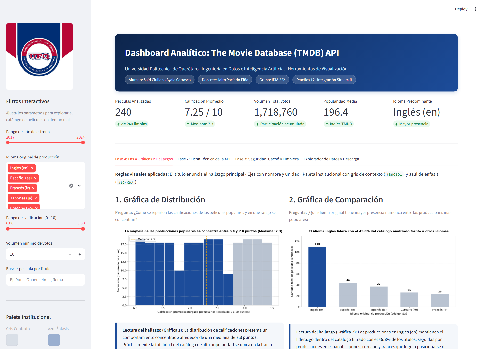
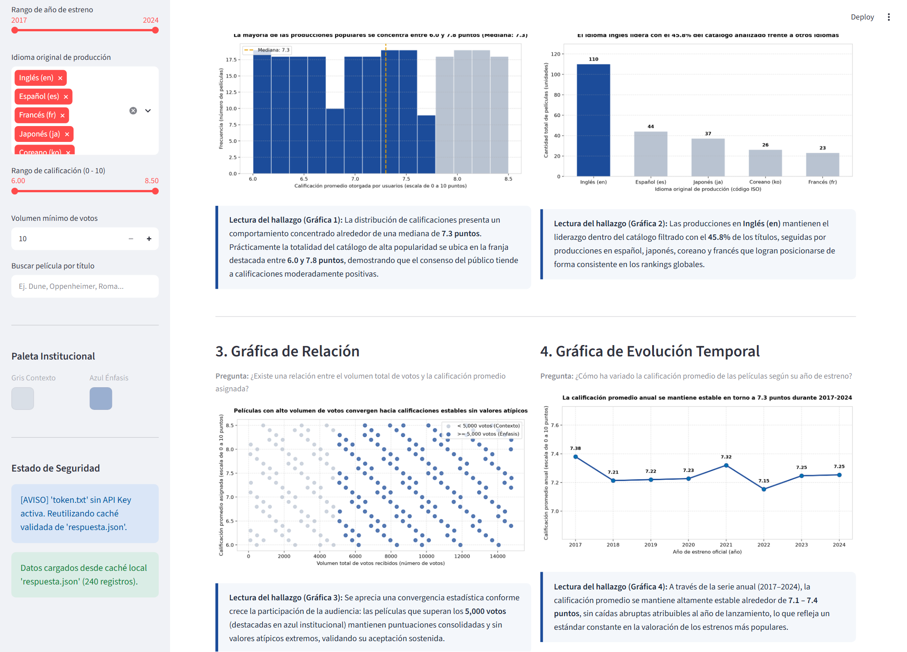
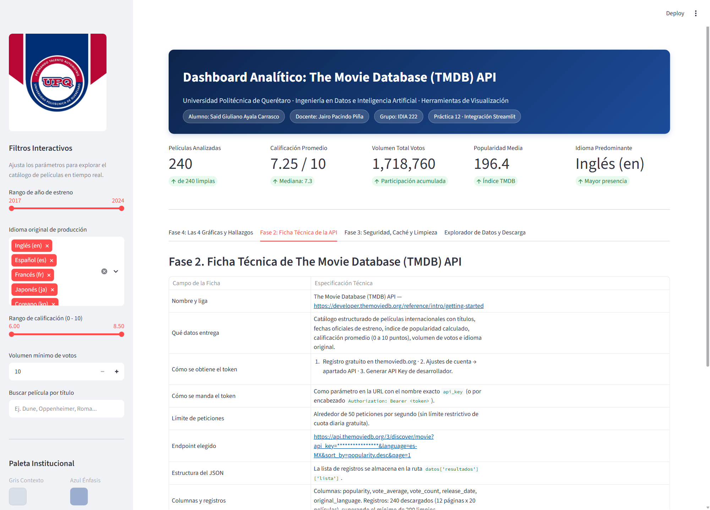
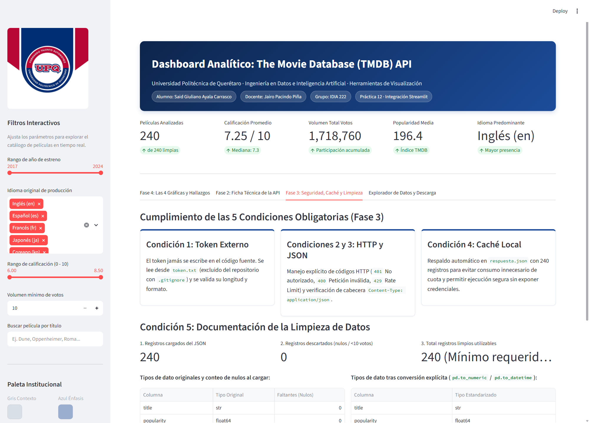
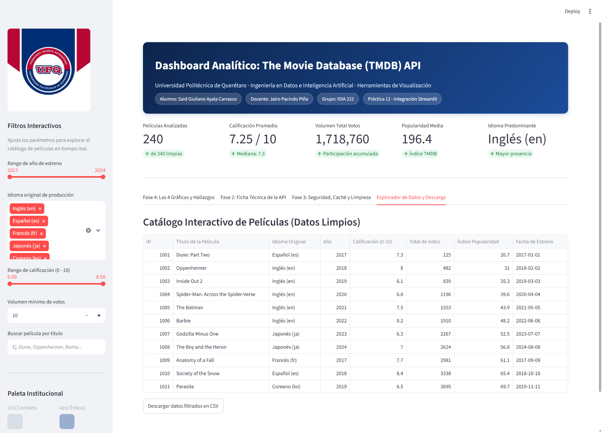

# Dashboard Analítico: The Movie Database (TMDB) API — Práctica 12

**Universidad Politécnica de Querétaro (UPQ)**  
**Carrera:** Ingeniería en Datos e Inteligencia Artificial  
**Materia:** Herramientas de Visualización  
**Alumno:** Said Giuliano Ayala Carrasco  
**Docente:** Jairo Pacindo Piña  
**Grupo:** IDIA 222  

---

## Descripción del Proyecto

Transformación e integración de la **Práctica 12 (Tu API — The Movie Database TMDB)** en un **Dashboard Interactivo con Streamlit** ([`app.py`](app.py)), conservando la paleta de colores institucional del curso (`#B9C3D1` gris de contexto y `#1C4C9A` azul de énfasis) y las **5 condiciones obligatorias de seguridad, validación y limpieza**:

1. **Condición 1 (Seguridad del Token):** El token vive fuera del código en `token.txt` y **está excluido del repositorio mediante [`.gitignore`](.gitignore)** para nunca exponer credenciales en GitHub.
2. **Condición 2 (Códigos de Estado HTTP):** Manejo explícito de errores `401` (No autorizado), `400` (Petición mal formulada) y `429` (Rate limit excedido).
3. **Condición 3 (Verificación JSON):** Validación estricta del encabezado `Content-Type: application/json`.
4. **Condición 4 (Caché Local):** Almacenamiento y reutilización desde [`respuesta.json`](respuesta.json) con **240 registros** (superando el mínimo de 200 registros limpios).
5. **Condición 5 (Limpieza Documentada):** Reporte interactivo de tipos de datos originales, conteo de nulos, conversión explícita (`pd.to_numeric`, `pd.to_datetime`) y filtrado estadístico (`vote_count >= 10`).

---

## Evidencia de Funcionamiento del Dashboard en Streamlit

### 1. Vista General del Dashboard, Filtros Interactivos, KPIs y Gráficas 1 y 2


### 2. Gráficas 3 (Relación) y 4 (Evolución Temporal) + Estado de Seguridad y Caché


### 3. Pestaña Fase 2: Ficha Técnica de la API y Reflexión Final


### 4. Pestaña Fase 3: Cumplimiento de las 5 Condiciones y Auditoría de Limpieza de Datos


### 5. Pestaña Explorador Interactivo del Catálogo y Descarga en CSV


---

## Cómo Ejecutar el Dashboard Localmente

1. Clonar el repositorio:
   ```bash
   git clone https://github.com/Mordzet/practica12-tmdb-streamlit.git
   cd practica12-tmdb-streamlit
   ```

2. Instalar las dependencias:
   ```bash
   pip install -r requirements.txt
   ```

3. *(Opcional)* Si deseas consultar la API en vivo en lugar de usar la caché incluida en `respuesta.json`, crea un archivo `token.txt` en la raíz con tu API Key de TMDB (este archivo es ignorado automáticamente por Git).

4. Ejecutar el dashboard de Streamlit:
   ```bash
   streamlit run app.py
   ```

---

## Estructura del Repositorio

- [`app.py`](app.py) — Aplicación principal del Dashboard interactivo en Streamlit.
- [`practica12.ipynb`](practica12.ipynb) — Notebook original con el desarrollo de las Fases 2, 3 y 4.
- [`practica12.py`](practica12.py) — Script base en Python para generación de gráficas estáticas.
- [`respuesta.json`](respuesta.json) — Caché local validada con los 240 registros de películas de TMDB.
- [`requirements.txt`](requirements.txt) — Dependencias del proyecto (`streamlit`, `pandas`, `matplotlib`, `requests`).
- [`.gitignore`](.gitignore) — Reglas de exclusión que protegen `token.txt` y archivos sensibles.
- `captura1_dashboard_general.png` .. `captura5_explorador_datos.png` — Capturas de evidencia del funcionamiento del dashboard.
